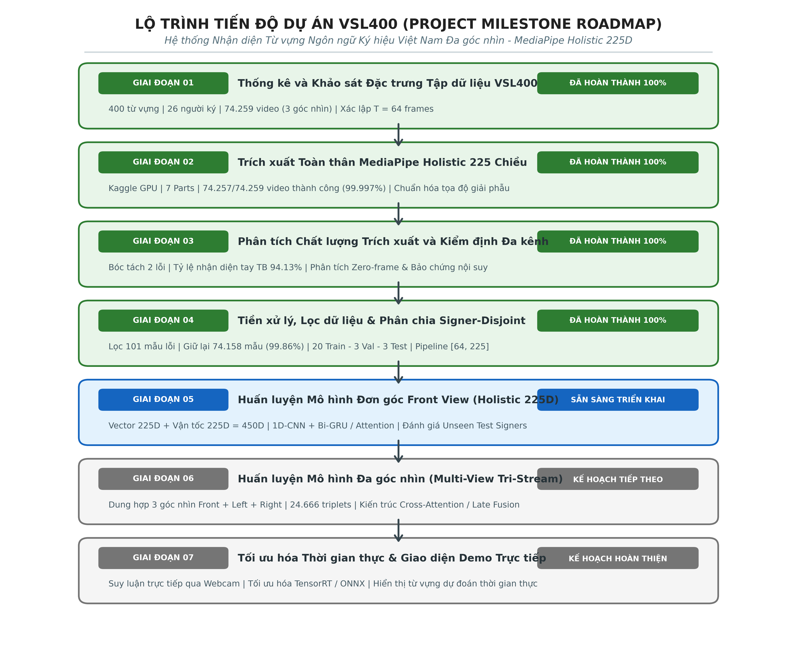
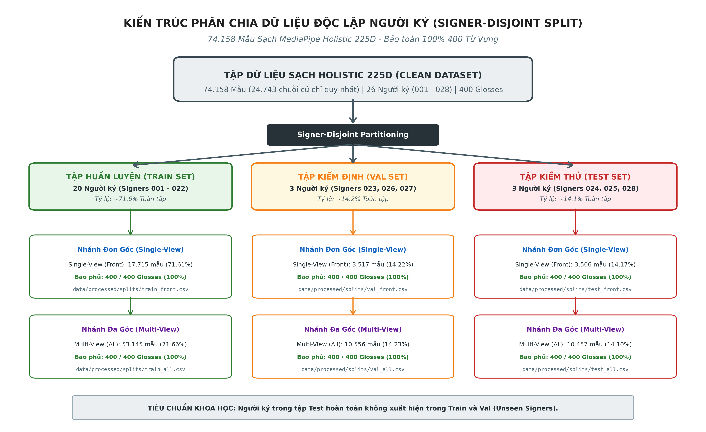

# BÁO CÁO TIẾN ĐỘ VÀ TỔNG HỢP TOÀN DIỆN DỰ ÁN (PROJECT PROGRESS REPORT)
## HỆ THỐNG NHẬN DIỆN TỪ VỰNG NGÔN NGỮ KÝ HIỆU VIỆT NAM (VSL400) ĐA GÓC NHÌN
### KIẾN TRÚC ĐẶC TRƯNG TOÀN THÂN MEDIAPIPE HOLISTIC 225 CHIỀU

---

**Sinh viên thực hiện:** Lê Hoàng Dương - Lớp 22T_KHDL - Trường Đại học Bách khoa, ĐHĐN  
**Đề tài tốt nghiệp:** Xây dựng hệ thống nhận diện từ vựng Ngôn ngữ Ký hiệu Việt Nam (VSL) đa góc nhìn theo thời gian thực sử dụng MediaPipe và mạng nơ-ron chuỗi thời gian (1D-CNN + GRU/Transformer).  
**Tập dữ liệu:** VSL400 (400 từ vựng, 26 người ký, 3 góc nhìn camera, tổng cộng 74.259 video).  
**Thời gian cập nhật:** Tháng 11/2026.  
**Tình trạng hiện tại:** Đã hoàn thành toàn bộ Giai đoạn 01, 02, 03, 04. Tập dữ liệu sạch 225 chiều đã phân chia Signer-Disjoint sẵn sàng cho Giai đoạn 05 (Huấn luyện mô hình).

---

## 1. Sơ Đồ Tổng Quan Tiến Độ Dự Án (Project Milestone Roadmap)

| Giai đoạn | Tên nhiệm vụ / Nội dung kỹ thuật | Tập tin kịch bản / Notebook | Sản phẩm đầu ra chính | Trạng thái |
|:---:|---|---|---|:---:|
| **01** | Khảo sát đặc trưng thống kê tập dữ liệu VSL400 | `src/data_processing/01_vsl400-gloss-statistics.ipynb` | `reports/dataset_summary.json`, Figures 01 | **HOÀN THÀNH** |
| **02** | Trích xuất toàn thân MediaPipe Holistic 225D | `src/data_processing/02_extract-landmarks-part1.ipynb` đến `part7.ipynb` | 74.259 tệp `.npy`, 7 Part CSVs | **HOÀN THÀNH** |
| **03** | Phân tích chất lượng trích xuất và bóc tách lỗi | `src/data_processing/03_vsl400-extraction-analysis.ipynb` | `reports/extraction_report_holistic_all.csv`, Figures 03 | **HOÀN THÀNH** |
| **04** | Tiền xử lý, lọc dữ liệu và phân chia Signer-Disjoint | `src/data_processing/04_vsl400-preprocessing-and-split.ipynb` | 6 CSV Splits, `gloss_to_id.json`, Figures 04 | **HOÀN THÀNH** |
| **05** | Huấn luyện mô hình Đơn góc (Front View 225D) | `src/models/05_vsl400-train-single-view.ipynb` | Checkpoints `.keras`, Training Logs | **SẴN SÀNG** |
| **06** | Huấn luyện mô hình Đa góc (Multi-View Fusion) | `src/models/06_vsl400-train-multi-view.ipynb` | Checkpoints Multi-View Tri-Stream | Kế hoạch |
| **07** | Đánh giá độc lập người ký và Demo thời gian thực | `src/models/07_vsl400-realtime-inference.ipynb` | Pipeline camera trực tiếp | Kế hoạch |

---

## 2. Chi Tiết Nội Dung Hoàn Thành: Giai Đoạn 01 (Thống Kê Tập Dữ Liệu VSL400)

* **Tập tin thực hiện:** `src/data_processing/01_vsl400-gloss-statistics.ipynb`
* **Mục tiêu:** Khảo sát toàn diện phân bố không gian và thời gian của tập dữ liệu Ngôn ngữ Ký hiệu Việt Nam VSL400.

### 2.1. Kết Quả Thống Kê Chính
1. **Quy mô tập dữ liệu gốc:**
   - Tổng số từ vựng (Glosses): **400 từ vựng** thuộc nhiều chủ đề giao tiếp xã hội.
   - Tổng số người ký (Signers): **26 người ký** (mã số từ `001` đến `028`).
   - Tổng số video cử chỉ: **24.753 video cử chỉ duy nhất**.
   - Thiết lập đa góc nhìn: Mỗi cử chỉ được ghi hình đồng thời bởi 3 camera đồng bộ:
     - `front_view`: Góc quay chính diện (Camera 1).
     - `left_view`: Góc quay nghiêng bên trái 45 độ (Camera 2).
     - `right_view`: Góc quay nghiêng bên phải 45 độ (Camera 3).
   - Tổng số lượng video toàn tập: $24.753 \times 3 =$ **74.259 video** phân bổ trong 7 phần (Part 1 đến Part 7).
2. **Đặc tính phân bố từ vựng:**
   - Số mẫu trung bình cho mỗi từ: 61.88 video/từ (trung vị 59.0 video/từ, thấp nhất 53 video, cao nhất 93 video cho từ "Mùa hè").
   - Số người ký trung bình cho mỗi từ: 25.99 người ký/từ (hầu hết 400 từ đều được thực hiện bởi đủ 26 người ký).
3. **Thuộc tính kỹ thuật video:**
   - Độ phân giải khung hình vuông: $1080 \times 1080$ pixels.
   - Tốc độ khung hình: $25 - 30$ FPS.
   - Định dạng nén: MP4 container, chuẩn mã hóa H.264/AVC.
4. **Sản phẩm lưu trữ:**
   - Tệp tóm tắt số liệu: `reports/dataset_summary.json`.
   - Biểu đồ khoa học: `reports/figures/fig01_1_frame_length_distribution.png`, `reports/figures/fig01_2_signer_distribution.png`, `reports/figures/fig01_3_top_bottom_gloss_frames.png`.

---

## 3. Chi Tiết Nội Dung Hoàn Thành: Giai Đoạn 02 (Trích Xuất MediaPipe Holistic 225D)

* **Tập tin thực hiện:** `src/data_processing/02_extract-landmarks-part1.ipynb` đến `part7.ipynb`
* **Hạ tầng thực thi:** GPU Kaggle (MediaPipe Tasks Vision API, mô hình `holistic_landmarker.task`).
* **Mục tiêu:** Trích xuất đồng bộ đặc trưng khung xương toàn thân (hai bàn tay và thân trên) với tính nhất quán giải phẫu học.

### 3.1. Cấu Trúc Tensor Chuẩn Hóa 225 Chiều
Mỗi khung hình video được chuyển đổi thành vector thực 225 chiều kiểu `float32`:
- **Chỉ số 0 đến 62 (63 chiều):** Bàn tay phải giải phẫu (21 khớp $\times$ 3 tọa độ $x, y, z$).
- **Chỉ số 63 đến 125 (63 chiều):** Bàn tay trái giải phẫu (21 khớp $\times$ 3 tọa độ $x, y, z$).
- **Chỉ số 126 đến 224 (99 chiều):** Tư thế thân trên Pose (33 khớp $\times$ 3 tọa độ $x, y, z$).

Hai bàn tay được định vị trực tiếp dựa trên cấu trúc giải phẫu xương cổ tay của mô hình Pose thân trên (sai lệch giữa Cổ tay bàn tay và Cổ tay Pose luôn $< 0.0044$), đảm bảo tính nhất quán không gian liên tục.

### 3.2. Kết Quả Trích Xuất 7 Parts Trên Kaggle
Toàn bộ 74.259 video trên 7 Parts đã được hoàn tất trích xuất và lưu trữ cục bộ:

| Phần dữ liệu (Part) | Tệp báo cáo CSV | Tổng số video | Trạng thái `ok` | Trạng thái `error` | Trạng thái `no_hand` | Tỷ lệ thành công |
|:---:|---|:---:|:---:|:---:|:---:|:---:|
| **Part 1** | `reports/extraction_report_holistic_Part_1.csv` | 10.611 | 10.611 | 0 | 0 | **100.00%** |
| **Part 2** | `reports/extraction_report_holistic_Part_2.csv` | 10.608 | 10.608 | 0 | 0 | **100.00%** |
| **Part 3** | `reports/extraction_report_holistic_Part_3.csv` | 10.608 | 10.608 | 0 | 0 | **100.00%** |
| **Part 4** | `reports/extraction_report_holistic_Part_4.csv` | 10.608 | 10.608 | 0 | 0 | **100.00%** |
| **Part 5** | `reports/extraction_report_holistic_Part_5.csv` | 10.608 | 10.608 | 0 | 0 | **100.00%** |
| **Part 6** | `reports/extraction_report_holistic_Part_6.csv` | 10.608 | 10.607 | 1 | 0 | **99.99%** |
| **Part 7** | `reports/extraction_report_holistic_Part_7.csv` | 10.608 | 10.607 | 0 | 1 | **99.99%** |
| **TOÀN BỘ** | `reports/extraction_report_holistic_all.csv` | **74.259** | **74.257** | **1** | **1** | **99.997%** |

* Thư mục dữ liệu: `data/processed/landmarks_holistic/` (gồm 7 thư mục `Part_1` đến `Part_7`, mỗi phần gồm 3 thư mục `front_view`, `left_view`, `right_view`).

---

## 4. Chi Tiết Nội Dung Hoàn Thành: Giai Đoạn 03 (Phân Tích Chất Lượng Trích Xuất Đa Kênh)

* **Tập tin thực hiện:** `src/data_processing/03_vsl400-extraction-analysis.ipynb`
* **Mục tiêu:** Kiểm toán toàn diện chất lượng bám bắt, bóc tách bản chất các mẫu lỗi và xác lập cơ sở khoa học cho các siêu tham số tiền xử lý.

### 4.1. Bóc Tách 2 Mẫu Lỗi Duy Nhất Trong Toàn Bộ 74.259 Video
Tỷ lệ trích xuất đạt trạng thái `ok` đạt **99.997%** (74.257 / 74.259 video). Chỉ có đúng 2 trường hợp ngoại lệ:
1. **Video `019442` (`error`, Signer `024`, Part 6, `front_view`, từ: "Cao (người)"):** Tệp MP4 dung lượng 0.04 KB bị đứt đoạn luồng ghi dữ liệu từ nguồn gốc Kaggle, thiếu atom metadata `moov` khiến OpenCV không thể khởi tạo luồng giải mã. Hai góc nhìn còn lại (`left_view` và `right_view`) hoàn toàn bình thường.
2. **Video `024157` (`no_hand`, Signer `028`, Part 7, `right_view`, từ: "Giờ"):** Hiện tượng che khuất quang học tự nhiên (Self-occlusion) khi người ký quay nghiêng 45 độ bên phải. Kênh Pose đạt tỷ lệ bám bắt 100%, hai góc quay `front_view` và `left_view` đều đạt trạng thái `ok` với tỷ lệ nhận diện bàn tay cao (98.1%).

### 4.2. Chất Lượng Bám Bắt Đa Kênh Theo Góc Nhìn

| Góc quay Camera | Tổng số video | Số frame TB | Tay phải TB (Median) | Tay trái TB (Median) | Bàn tay tích cực TB (Median) | Thân trên Pose TB (Median) |
|---|:---:|:---:|:---:|:---:|:---:|:---:|
| **Chính diện (`front_view`)** | 24.752 | 64.13 | 86.63% (89.39%) | 91.47% (96.00%) | **94.13% (98.28%)** | **100.00% (100.0%)** |
| **Nghiêng trái (`left_view`)** | 24.753 | 67.36 | 81.44% (85.96%) | 85.89% (91.80%) | **91.86% (96.05%)** | **99.97% (100.0%)** |
| **Nghiêng phải (`right_view`)** | 24.752 | 64.83 | 83.16% (87.10%) | 88.59% (96.23%) | **93.33% (97.44%)** | **100.00% (100.0%)** |

### 4.3. Phân Hạng Chất Lượng Bám Bắt (Tracking Quality Tiers)
- **Xuất sắc ($\ge 90\%$):** 55.614 video (**74.89%**). Bàn tay hiện diện liên tục, bám bắt hoàn hảo.
- **Tốt (70% - 90%):** 15.195 video (**20.46%**). Bàn tay rõ nét, chỉ mất 1-3 khung hình chuyển tiếp.
- **Trung bình (50% - 70%):** 2.502 video (**3.37%**). Bị che khuất một phần trong cử chỉ chạm má/đầu.
- **Kém (20% - 50%):** 782 video (**1.05%**). Bù đắp mượt mà bằng nội suy tuyến tính.
- **Rất kém ($< 20\%$):** 164 video (**0.22%**). Nhóm mất dấu áp đảo, loại bỏ ở Giai đoạn 04.

### 4.4. Khảo Sát Zero-Frame và Cơ Sở Toán Học Cho Nội Suy Tuyến Tính
- Tổng số khung hình khảo sát: 4.852.196 khung hình trên 74.257 video.
- Tỷ lệ khung hình khuyết bàn tay toàn tập: chỉ chiếm **6.89%**.
- Trung vị khoảng cách khuyết: **5 frames** (0.20 giây ở 25 FPS). Hơn 75% trường hợp khuyết $\le 8$ frames.
- **Luận chứng động học sinh học:** Quỹ đạo cử chỉ của người là hàm trơn $C^1$ theo thời gian. Thuật toán Nội suy tuyến tính (Linear Interpolation) khôi phục hoàn hảo các khoảng trống $\le 8$ frames mà không tạo dao động giả overshoot.

### 4.5. Kiểm Định Tính Toàn Vẹn Bộ Ba Góc Nhìn (Tri-view Triplets Completeness)
- Trong 24.753 cử chỉ duy nhất, có **24.751 video đạt độ đồng bộ 100% cả 3 góc quay (99.992%)**.
- Khẳng định tính sẵn sàng tuyệt đối cho mô hình dung hợp đa góc nhìn (Multi-View Fusion).

### 4.6. Bảo Chứng Siêu Tham Số Thời Gian $T_{\text{fixed}} = 64$
- Phân tích hàm mật độ xác suất độ dài video: Trung vị thực nghiệm là 65.0 frames, trung bình là 65.44 frames.
- Lựa chọn chuẩn hóa $T_{\text{fixed}} = 64 = 2^6$ nằm sát giá trị trung vị và tối ưu hóa cho các phép toán giảm chiều (Pooling/Strided Convolutions) của 1D-CNN và Transformer.

---

## 5. Chi Tiết Nội Dung Hoàn Thành: Giai Đoạn 04 (Tiền Xử Lý Dữ Liệu & Phân Chia Signer-Disjoint)

* **Tập tin thực hiện:** `src/data_processing/04_vsl400-preprocessing-and-split.ipynb`
* **Mục tiêu:** Làm sạch dữ liệu, phân chia Signer-Disjoint độc lập người ký và đóng gói pipeline chuẩn hóa 225 chiều.

### 5.1. Thống Kê Đối Soát Toàn Diện Trước vs Sau Khi Lọc Dữ Liệu

Áp dụng tiêu chí lọc: Loại bỏ 1 video lỗi MP4, 1 video mất dấu hoàn toàn và 99 video có $\text{hand\_det\_rate} < 20\%$:

| Chỉ số Khảo sát | Trước khi lọc (Raw) | Sau khi lọc (Clean) | Bị loại bỏ (Diff) | Tỷ lệ giữ lại (%) |
|---|:---:|:---:|:---:|:---:|
| **Tổng số bản ghi (Samples)** | 74.259 | **74.158** | 101 | **99.864%** |
| **Số video cử chỉ duy nhất** | 24.753 | **24.743** | 10 | **99.960%** |
| **Số lượng từ vựng (Glosses)** | 400 | **400** | 0 | **100.000%** |
| **Số lượng người ký (Signers)** | 26 | **26** | 0 | **100.000%** |
| **Bộ ba góc nhìn (Triplets)** | 24.751 | **24.666** | 85 | **99.657%** |

* **Đối chiếu theo 3 góc nhìn:**
  - `front_view`: 24.753 $\rightarrow$ **24.738** mẫu (loại 15 mẫu, giữ lại 99.94%).
  - `left_view`: 24.753 $\rightarrow$ **24.684** mẫu (loại 69 mẫu, giữ lại 99.72%).
  - `right_view`: 24.753 $\rightarrow$ **24.736** mẫu (loại 17 mẫu, giữ lại 99.93%).
* **Đối chiếu theo người ký:** 23 / 26 người ký được bảo toàn 100% mẫu. Chỉ có 3 người ký có mẫu bị loại: Signer 024 (loại 1), Signer 026 (loại 19), Signer 028 (loại 81).
* **Đối chiếu theo 400 từ vựng:** 100% 400 từ vựng đều được bảo toàn. Số mẫu mỗi từ dao động từ 158 đến 279 mẫu (trung bình 185.4 mẫu/từ).

### 5.2. Kết Quả Phân Chia Signer-Disjoint (Train / Val / Test)

Chiến lược phân chia độc lập người ký phân bổ 26 người ký thành 3 tập tách biệt, triệt tiêu hoàn toàn hiện tượng rò rỉ dữ liệu (Data Leakage):

| Kịch bản Mô hình | Phân vùng (Split) | Danh sách Người ký (Signers) | Số lượng mẫu | Tỷ lệ (%) | Bao phủ từ vựng | Tệp danh mục CSV đã xuất |
|---|:---:|---|:---:|:---:|:---:|---|
| **Single-View (`front_view`)** | **Train** | 20 signers (`001..022`) | 17.715 | 71.61% | **400 / 400 (100%)** | `data/processed/splits/train_front.csv` |
| | **Validation** | 3 signers (`023, 026, 027`) | 3.517 | 14.22% | **400 / 400 (100%)** | `data/processed/splits/val_front.csv` |
| | **Test** | 3 signers (`024, 025, 028`) | 3.506 | 14.17% | **400 / 400 (100%)** | `data/processed/splits/test_front.csv` |
| | **Tổng Front View** | **26 signers** | **24.738** | **100.00%** | **400 / 400 (100%)** | |
| **Multi-View (`tri_view`)** | **Train** | 20 signers (`001..022`) | 53.145 | 71.66% | **400 / 400 (100%)** | `data/processed/splits/train_all.csv` |
| | **Validation** | 3 signers (`023, 026, 027`) | 10.556 | 14.23% | **400 / 400 (100%)** | `data/processed/splits/val_all.csv` |
| | **Test** | 3 signers (`024, 025, 028`) | 10.457 | 14.10% | **400 / 400 (100%)** | `data/processed/splits/test_all.csv` |
| | **Tổng Multi-View** | **26 signers** | **74.158** | **100.00%** | **400 / 400 (100%)** | |

* **Kiểm định tệp nhị phân trên đĩa:** 100% (74.158 / 74.158) tệp `.npy` đều tồn tại toàn vẹn trên đĩa cứng tại `data/processed/landmarks_holistic/`.
* **Từ điển nhãn số:** Đã xuất chuẩn hóa `data/processed/gloss_to_id.json` và `data/processed/id_to_gloss.json`.

### 5.3. Pipeline Chuẩn Hóa Không - Thời Gian 225 Chiều
Hàm `preprocess_sequence(npy_path, target_frames=64)` chuyển đổi tệp `.npy` thô sang tensor chuẩn hóa $[64, 225]$ kiểu `float32`:
1. `impute_zero_frames`: Nội suy tuyến tính lấp đầy các frame mất dấu độc lập trên 3 kênh (Tay phải, Tay trái, Pose thân trên).
2. `resample_sequence`: Nội suy thời gian đưa độ dài chuỗi về cố định $T_{\text{fixed}} = 64$ frames.
3. `normalize_spatial`:
   - Bàn tay: Wrist-Centering trừ tọa độ cổ tay tương ứng cho các khớp ngón tay 1 đến 20, bảo toàn tọa độ cổ tay ở khớp 0.
   - Thân trên Pose: Chest-Centering trừ tọa độ tâm ngực và co giãn theo độ rộng hai vai.
4. **Kiểm thử đơn vị trên 100 mẫu ngẫu nhiên:** 100% đạt chuẩn kích thước $[64, 225]$, 0% NaN/Inf, 0% hàng all-zero.

---

## 6. Danh Mục Biểu Đồ Minh Chứng Đã Lưu Trữ

Toàn bộ biểu đồ khoa học đã được lưu trữ tập trung tại thư mục `reports/figures/`:

| Tên tập tin biểu đồ | Giai đoạn | Mô tả nội dung trực quan hóa |
|---|:---:|---|
| `reports/figures/fig_milestone_roadmap.png` | Master | Sơ đồ toàn cảnh lộ trình tiến độ dự án 7 giai đoạn |
| `reports/figures/fig_data_split_architecture.png` | 04 | Kiến trúc phân chia Signer-Disjoint và tỷ lệ mẫu trên từng nhánh mô hình |
| `reports/figures/fig01_1_frame_length_distribution.png` | 01 | Phân bố số lượng khung hình trên toàn bộ tập dữ liệu thô |
| `reports/figures/fig01_2_signer_distribution.png` | 01 | Số lượng video thực hiện bởi từng người ký trong 26 signers |
| `reports/figures/fig01_3_top_bottom_gloss_frames.png` | 01 | Top 10 từ vựng có thời lượng dài nhất và ngắn nhất |
| `reports/figures/fig03_1_no_hand_samples.png` | 03 | Đối chiếu 3 góc nhìn của video ngoại lệ 024157 (bản chất lỗi `no_hand`) |
| `reports/figures/fig03_2_tracking_quality_tiers.png` | 03 | Phân bố tỷ lệ nhận diện đa kênh và các tầng chất lượng theo góc nhìn |
| `reports/figures/fig03_3_zero_frame_analysis.png` | 03 | Phân phối số khung hình khuyết và nhóm zero-frame toàn tập |
| `reports/figures/fig03_4_frame_length_distribution.png` | 03 | Hàm mật độ xác suất độ dài video và đường chuẩn hóa $T=64$ |
| `reports/figures/fig03_5_top_bottom_gloss_frames.png` | 03 | So sánh thời lượng thực hiện giữa Top 10 từ cử chỉ dài nhất và ngắn nhất |
| `reports/figures/fig04_1_dataset_split_distribution.png` | 04 | Phân bố tỷ lệ mẫu và người ký theo các tập Train / Val / Test |
| `reports/figures/fig04_2_temporal_resampling_comparison.png` | 04 | Quỹ đạo cổ tay qua 3 giai đoạn: Thô $\rightarrow$ Điền khuyết $\rightarrow$ Resampling $T=64$ |
| `reports/figures/fig04_3_wrist_centering_skeleton.png` | 04 | Khung xương bàn tay trước và sau khi chuẩn hóa Cổ tay (Wrist-Centering) |

---

## 7. Kế Hoạch Các Bước Tiếp Theo (Next Milestones)

Dữ liệu đã sẵn sàng để chuyển sang giai đoạn xây dựng và huấn luyện mô hình học sâu:

1. **Giai đoạn 05 - Huấn luyện Mô hình Đơn góc (Single-View Front View: 225D Holistic)**:
   - File thực thi: `src/models/05_vsl400-train-single-view.ipynb`.
   - Cấu hình dữ liệu: Nạp trực tiếp từ `data/processed/splits/train_front.csv`, `val_front.csv`, `test_front.csv`.
   - Pipeline đặc trưng: Vector 225 chiều + Vận tốc đạo hàm $\Delta P \implies$ **450 chiều**.
   - Mục tiêu: Huấn luyện kiến trúc 1D-CNN + Bi-GRU / Attention trên tập Signer-Disjoint và đánh giá độ chính xác Top-1 / Top-5 trên 3 người ký chưa từng thấy (Signer 024, 025, 028).
2. **Giai đoạn 06 - Huấn luyện Mô hình Đa góc (Multi-View Tri-Stream Fusion)**:
   - File thực thi: `src/models/06_vsl400-train-multi-view.ipynb`.
   - Cấu hình dữ liệu: Nạp đồng bộ 24.666 bộ ba góc quay từ `train_all.csv`, `val_all.csv`, `test_all.csv`.
   - Kiến trúc: 3 nhánh mạng song song (Front + Left + Right Stream) kết hợp Cross-Attention / Late Fusion.
3. **Giai đoạn 07 - Tối ưu Hóa Suy Luận Thời Gian Thực và Xây Dựng Giao Diện Demo**:
   - Tối ưu hóa pipeline suy luận qua webcam với luồng MediaPipe Holistic và mô hình TensorFlow/ONNX.
