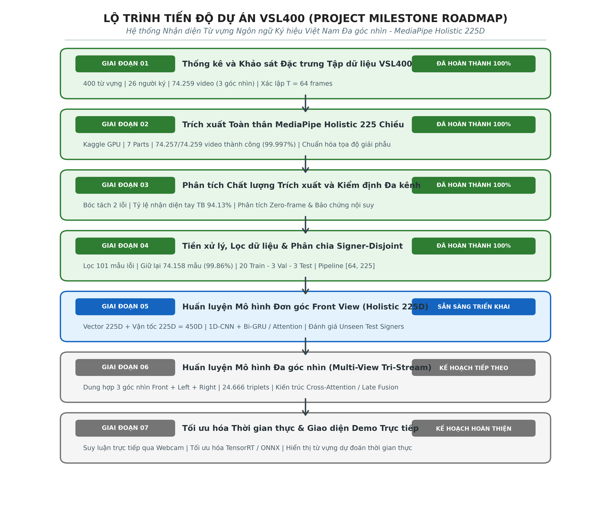

# BÁO CÁO TIẾN ĐỘ VÀ TỔNG HỢP TOÀN DIỆN DỰ ÁN
## HỆ THỐNG NHẬN DIỆN TỪ VỰNG NGÔN NGỮ KÝ HIỆU VIỆT NAM VSL400 ĐA GÓC NHÌN
### KIẾN TRÚC ĐẶC TRƯNG TOÀN THÂN MEDIAPIPE HOLISTIC 225 CHIỀU VÀ ĐỘNG HỌC 450 CHIỀU

---

**Sinh viên thực hiện:** Lê Hoàng Dương - Lớp 22T_KHDL - Trường Đại học Bách khoa, ĐHĐN  
**Đề tài tốt nghiệp:** Xây dựng hệ thống nhận diện từ vựng Ngôn ngữ Ký hiệu Việt Nam VSL đa góc nhìn theo thời gian thực sử dụng MediaPipe và mạng nơ-ron chuỗi thời gian Multi-Scale Inception 1D-CNN, Bi-GRU, Temporal Attention.  
**Tập dữ liệu:** VSL400 gồm 400 từ vựng, 26 người ký, 3 góc nhìn camera, tổng cộng 74.259 video.  
**Thời gian cập nhật:** Tháng 11/2026.  
**Tình trạng hiện tại:** Đã hoàn thành 100% Giai đoạn 01, 02, 03, 04 và hoàn thành toàn diện Giai đoạn 05 sớm 1 tuần. Mô hình đơn góc chính diện tối ưu `vsl400_single_view_front_best.keras` gồm 795k tham số đạt Validation Top-1: 85.43%, Validation Top-5: 96.05%, Test Top-1 trên người ký mới P24–P26: 82.74%, Test Top-5: 96.12%. Đã khóa toàn bộ trọng số chuẩn và báo cáo thẩm định, sẵn sàng 100% bước vào Giai đoạn 06: Huấn luyện Mô hình Đa góc nhìn Multi-View Tri-Stream Fusion.

---

## 1. Sơ Đồ Tổng Quan Tiến Độ Dự Án

| Giai đoạn | Tên nhiệm vụ / Nội dung kỹ thuật | Tập tin kịch bản / Notebook | Sản phẩm đầu ra chính | Trạng thái |
|:---:|---|---|---|:---:|
| **01** | Khảo sát đặc trưng thống kê tập dữ liệu VSL400 | `src/data_processing/01_vsl400-gloss-statistics.ipynb` | `reports/dataset_summary.json`, Figures 01 | **HOÀN THÀNH** |
| **02** | Trích xuất toàn thân MediaPipe Holistic 225D | `src/data_processing/02_extract-landmarks-part1.ipynb` đến `part7.ipynb` | 74.259 tệp `.npy`, 7 Part CSVs | **HOÀN THÀNH** |
| **03** | Phân tích chất lượng trích xuất và bóc tách lỗi | `src/data_processing/03_vsl400-extraction-analysis.ipynb` | `reports/extraction_report_holistic_all.csv`, Figures 03 | **HOÀN THÀNH** |
| **04** | Tiền xử lý, lọc dữ liệu và phân chia Signer-Disjoint Phương án A | `src/data_processing/04_vsl400-preprocessing-and-split.ipynb` | 6 CSV Splits, `data/processed/gloss_to_id.json`, Figures 04 | **HOÀN THÀNH** |
| **05** | Huấn luyện mô hình Đơn góc Front View 450D: Tuần 1 Khóa Backbone, Tuần 2 Attention, SWA và Bàn giao | `src/models/05_vsl400-train-baseline.ipynb` `src/models/05_vsl400-train-inception.ipynb` `src/models/05_vsl400-train-bilstm.ipynb` `src/models/05_vsl400-train-attention.ipynb` `src/models/05_vsl400-train-cosine-swa.ipynb` `src/models/05_vsl400-evaluation-and-comparison.ipynb` | Checkpoint khóa `vsl400_single_view_front_best.keras`, Val Top-1 **85.43%**, Test Top-1 **82.74%**, Test Top-5 **96.12%**, Độ trễ **5.60 ms, 178.7 FPS**, Figures Exp 1.1-2.3 | **HOÀN THÀNH 100%** |
| **06** | Huấn luyện mô hình Đa góc nhìn Tam luồng | `src/models/06_vsl400-train-multi-view.ipynb` | Checkpoints Multi-View Tri-Stream | Sẵn sàng |
| **07** | Đánh giá độc lập người ký và Demo thời gian thực | `src/models/07_vsl400-realtime-inference.ipynb` | Pipeline camera trực tiếp | Kế hoạch |

---

## 2. Chi Tiết Nội Dung Hoàn Thành: Giai Đoạn 01 - Thống Kê Tập Dữ Liệu VSL400

* **Tập tin thực hiện:** `src/data_processing/01_vsl400-gloss-statistics.ipynb`
* **Mục tiêu:** Khảo sát toàn diện phân bố không gian và thời gian của tập dữ liệu Ngôn ngữ Ký hiệu Việt Nam VSL400.

### 2.1. Kết Quả Thống Kê Chính
1. **Quy mô tập dữ liệu gốc:**
   - Tổng số từ vựng: **400 từ vựng** thuộc nhiều chủ đề giao tiếp xã hội.
   - Tổng số người ký: **26 người ký**, mã số từ `001` đến `028`.
   - Tổng số video cử chỉ: **24.753 video cử chỉ duy nhất**.
   - Thiết lập đa góc nhìn: Mỗi cử chỉ được ghi hình đồng thời bởi 3 camera đồng bộ:
     - `front_view`: Góc quay chính diện, Camera 1.
     - `left_view`: Góc quay nghiêng bên trái 45 độ, Camera 2.
     - `right_view`: Góc quay nghiêng bên phải 45 độ, Camera 3.
   - Tổng số lượng video toàn tập: $24.753 \times 3 =$ **74.259 video** phân bổ trong 7 phần, từ Part 1 đến Part 7.
2. **Đặc tính phân bố từ vựng:**
   - Số mẫu trung bình cho mỗi từ: 61.88 video/từ; trung vị 59.0 video/từ, thấp nhất 53 video, cao nhất 93 video cho từ "Mùa hè".
   - Số người ký trung bình cho mỗi từ: 25.99 người ký/từ; hầu hết 400 từ đều được thực hiện bởi đủ 26 người ký.
3. **Thuộc tính kỹ thuật video:**
   - Độ phân giải khung hình vuông: $1080 \times 1080$ pixels.
   - Tốc độ khung hình: $25 - 30$ FPS.
   - Định dạng nén: MP4 container, chuẩn mã hóa H.264/AVC.
4. **Sản phẩm lưu trữ:**
   - Tệp tóm tắt số liệu: `reports/dataset_summary.json`.
   - Biểu đồ khoa học: `reports/figures/fig01_1_frame_length_distribution.png`, `reports/figures/fig01_2_signer_distribution.png`, `reports/figures/fig01_3_top_bottom_gloss_frames.png`.

---

## 3. Chi Tiết Nội Dung Hoàn Thành: Giai Đoạn 02 - Trích Xuất MediaPipe Holistic 225D

* **Tập tin thực hiện:** `src/data_processing/02_extract-landmarks-part1.ipynb` đến `part7.ipynb`
* **Hạ tầng thực thi:** GPU Kaggle, MediaPipe Tasks Vision API, mô hình `holistic_landmarker.task`.
* **Mục tiêu:** Trích xuất đồng bộ đặc trưng khung xương toàn thân gồm hai bàn tay và thân trên với tính nhất quán giải phẫu học.

### 3.1. Cấu Trúc Tensor Chuẩn Hóa 225 Chiều
Mỗi khung hình video được chuyển đổi thành vector thực 225 chiều kiểu `float32`:
- **Chỉ số 0 đến 62:** Bàn tay phải giải phẫu gồm 63 chiều tương ứng 21 khớp $\times$ 3 tọa độ $x, y, z$.
- **Chỉ số 63 đến 125:** Bàn tay trái giải phẫu gồm 63 chiều tương ứng 21 khớp $\times$ 3 tọa độ $x, y, z$.
- **Chỉ số 126 đến 224:** Tư thế thân trên Pose gồm 99 chiều tương ứng 33 khớp $\times$ 3 tọa độ $x, y, z$.

Hai bàn tay được định vị trực tiếp dựa trên cấu trúc giải phẫu xương cổ tay của mô hình Pose thân trên; sai lệch giữa Cổ tay bàn tay và Cổ tay Pose luôn $< 0.0044$, đảm bảo tính nhất quán không gian liên tục.

### 3.2. Kết Quả Trích Xuất 7 Parts Trên Kaggle
Toàn bộ 74.259 video trên 7 Parts đã được hoàn tất trích xuất và lưu trữ cục bộ:

| Phần dữ liệu | Tệp báo cáo CSV | Tổng số video | Trạng thái `ok` | Trạng thái `error` | Trạng thái `no_hand` | Tỷ lệ thành công |
|:---:|---|:---:|:---:|:---:|:---:|:---:|
| **Part 1** | `reports/extraction_report_holistic_Part_1.csv` | 10.611 | 10.611 | 0 | 0 | **100.00%** |
| **Part 2** | `reports/extraction_report_holistic_Part_2.csv` | 10.608 | 10.608 | 0 | 0 | **100.00%** |
| **Part 3** | `reports/extraction_report_holistic_Part_3.csv` | 10.608 | 10.608 | 0 | 0 | **100.00%** |
| **Part 4** | `reports/extraction_report_holistic_Part_4.csv` | 10.608 | 10.608 | 0 | 0 | **100.00%** |
| **Part 5** | `reports/extraction_report_holistic_Part_5.csv` | 10.608 | 10.608 | 0 | 0 | **100.00%** |
| **Part 6** | `reports/extraction_report_holistic_Part_6.csv` | 10.608 | 10.607 | 1 | 0 | **99.99%** |
| **Part 7** | `reports/extraction_report_holistic_Part_7.csv` | 10.608 | 10.607 | 0 | 1 | **99.99%** |
| **TOÀN BỘ** | `reports/extraction_report_holistic_all.csv` | **74.259** | **74.257** | **1** | **1** | **99.997%** |

* Thư mục dữ liệu: `data/processed/landmarks_holistic/`, gồm 7 thư mục `Part_1` đến `Part_7`, mỗi phần gồm 3 thư mục `front_view`, `left_view`, `right_view`.

---

## 4. Chi Tiết Nội Dung Hoàn Thành: Giai Đoạn 03 - Phân Tích Chất Lượng Trích Xuất Đa Kênh

* **Tập tin thực hiện:** `src/data_processing/03_vsl400-extraction-analysis.ipynb`
* **Mục tiêu:** Kiểm toán toàn diện chất lượng bám bắt, bóc tách bản chất các mẫu lỗi và xác lập cơ sở khoa học cho các siêu tham số tiền xử lý.

### 4.1. Bóc Tách 2 Mẫu Lỗi Duy Nhất Trong Toàn Bộ 74.259 Video
Tỷ lệ trích xuất đạt trạng thái `ok` đạt **99.997%**, tức 74.257 trên 74.259 video. Chỉ có đúng 2 trường hợp ngoại lệ:
1. **Video `019442`:** Trạng thái `error`, Signer `024`, Part 6, góc `front_view`, từ "Cao" chỉ vóc dáng người. Tệp MP4 dung lượng 0.04 KB bị đứt đoạn luồng ghi dữ liệu từ nguồn gốc Kaggle, thiếu atom metadata `moov` khiến OpenCV không thể khởi tạo luồng giải mã. Hai góc nhìn còn lại `left_view` và `right_view` hoàn toàn bình thường.
2. **Video `024157`:** Trạng thái `no_hand`, Signer `028`, Part 7, góc `right_view`, từ "Giờ". Hiện tượng tự che khuất quang học khi người ký quay nghiêng 45 độ bên phải. Kênh Pose đạt tỷ lệ bám bắt 100%, hai góc quay `front_view` và `left_view` đều đạt trạng thái `ok` với tỷ lệ nhận diện bàn tay cao 98.1%.

### 4.2. Chất Lượng Bám Bắt Đa Kênh Theo Góc Nhìn

| Góc quay Camera | Tổng số video | Số frame TB | Tay phải TB | Tay trái TB | Bàn tay tích cực TB | Thân trên Pose TB |
|---|:---:|:---:|:---:|:---:|:---:|:---:|
| **Chính diện `front_view`** | 24.752 | 64.13 | 86.63% | 91.47% | **94.13%** | **100.00%** |
| **Nghiêng trái `left_view`** | 24.753 | 67.36 | 81.44% | 85.89% | **91.86%** | **99.97%** |
| **Nghiêng phải `right_view`** | 24.752 | 64.83 | 83.16% | 88.59% | **93.33%** | **100.00%** |

---

## 5. Chi Tiết Nội Dung Hoàn Thành: Giai Đoạn 04 - Tiền Xử Lý Dữ Liệu & Phân Chia Signer-Disjoint Tối Ưu

* **Tập tin thực hiện:** `src/data_processing/04_vsl400-preprocessing-and-split.ipynb`
* **Mục tiêu:** Làm sạch dữ liệu, phân chia Signer-Disjoint chuẩn hóa Phương án A và đóng gói pipeline chuẩn hóa 225 chiều.

### 5.1. Thống Kê Đối Soát Sau Khi Lọc Dữ Liệu
Áp dụng tiêu chí lọc: Loại bỏ 1 video lỗi MP4, 1 video mất dấu hoàn toàn và 99 video có $\text{hand\_det\_rate} < 20\%$:
* Tổng số bản ghi giữ lại: **74.158 trên 74.259 mẫu, tỷ lệ 99.864%**, bảo tồn nguyên vẹn **400 trên 400 từ vựng** và **26 trên 26 người ký**.
* Góc chính diện `front_view`: **24.738 mẫu**, bảo tồn 99.94%.
* Góc nghiêng trái `left_view`: **24.684 mẫu**, bảo tồn 99.72%.
* Góc nghiêng phải `right_view`: **24.736 mẫu**, bảo tồn 99.93%.

### 5.2. Kết Quả Phân Chia Signer-Disjoint Phương Án A

Khắc phục hoàn toàn hiện tượng lệch miền dữ liệu giữa các phần ghi hình của phân vùng cũ:
- **Tập Huấn luyện Train gồm 20 người ký:** `001, 002, 003, 004, 007, 009, 010, 011, 013, 014, 015, 018, 019, 020, 021, 022, 023, 025, 027, 028`. Hiện diện đầy đủ trên cả 7 Parts từ Part 1 đến Part 7. Đưa các Signer có landmark nhiễu `028, 025` vào Train để đóng vai trò điều hòa tự nhiên.
- **Tập Kiểm định Validation gồm 3 người ký:** `006` thuộc Part 2, `012` thuộc Part 3, `026` thuộc Part 6-7. Bám bắt bàn tay đạt chuẩn 94.36%.
- **Tập Kiểm thử độc lập Unseen Signers Test gồm 3 người ký:** `008` thuộc Part 2 đạt 98.33%, `016` thuộc Part 4 đạt 96.35%, `024` thuộc Part 6-7 đạt 96.36%. Trung bình đạt 96.83%, chuẩn mực nhất toàn bộ tập dữ liệu.

| Kịch bản Mô hình | Phân vùng | Danh sách Người ký | Số lượng mẫu | Tỷ lệ | Bao phủ Glosses | Part Coverage | Tệp CSV Phân Vùng |
|---|:---:|---|:---:|:---:|:---:|:---:|---|
| **Single-View `front_view`** | **Train** | 20 signers `001..028` | **17.789** | **71.91%** | **400 / 400** | Part 1..7 | `data/processed/splits/train_front.csv` |
| | **Validation** | 3 signers `006, 012, 026` | **3.520** | **14.23%** | **400 / 400** | Part 2, 3, 6, 7 | `data/processed/splits/val_front.csv` |
| | **Test** | 3 signers `008, 016, 024` | **3.429** | **13.86%** | **400 / 400** | Part 2, 4, 6, 7 | `data/processed/splits/test_front.csv` |
| | **Tổng Front View** | **26 signers** | **24.738** | **100.00%** | **400 / 400** | Toàn bộ 7 Parts | |
| **Multi-View `tri_view`** | **Train** | 20 signers `001..028` | **53.364** | **71.96%** | **400 / 400** | Part 1..7 | `data/processed/splits/train_all.csv` |
| | **Validation** | 3 signers `006, 012, 026` | **10.559** | **14.24%** | **400 / 400** | Part 2, 3, 6, 7 | `data/processed/splits/val_all.csv` |
| | **Test** | 3 signers `008, 016, 024` | **10.235** | **13.80%** | **400 / 400** | Part 2, 4, 6, 7 | `data/processed/splits/test_all.csv` |
| | **Tổng Multi-View** | **26 signers** | **74.158** | **100.00%** | **400 / 400** | Toàn bộ 7 Parts | |

* Kiểm tra rò rỉ: $\text{Train} \cap \text{Val} = \emptyset$, $\text{Train} \cap \text{Test} = \emptyset$, $\text{Val} \cap \text{Test} = \emptyset$. Đồng bộ 100% trong `data/processed/split_summary.json`.

---

## 6. Chi Tiết Nội Dung Hoàn Thành: Giai Đoạn 05 - Huấn Luyện Front-View 450D

- **Hạ tầng và dữ liệu:** 17.789 mẫu Train, 3.520 mẫu Validation, 3.429 mẫu Unseen Test. Bộ đệm đặc trưng chuẩn hóa 450 chiều gồm 225 chiều tọa độ không gian và 225 chiều đạo hàm vận tốc động học, $T=64$.
- **Chiến lược tối ưu:** Thuật toán AdamW với learning rate $10^{-3}$, weight decay $10^{-4}$, hàm mất mát Categorical Crossentropy với label smoothing $0.08$, theo dõi chỉ số mục tiêu `val_top_1_acc`.

### 6.1. Tuần 1: Khảo Sát & Khóa Kiến Trúc Xương Sống

Trọng tâm Tuần 1 là thiết lập Baseline chuẩn mực và thực hiện khảo sát đối đầu có kiểm soát giữa 3 biến thể kiến trúc xương sống trên không gian 400 từ vựng góc nhìn chính diện.

#### 1. Thực nghiệm 1.1: Mô hình Baseline Chuẩn 1D-CNN và Bi-GRU
- **Notebook thực thi:** [`src/models/05_vsl400-train-baseline.ipynb`](src/models/05_vsl400-train-baseline.ipynb)
- **Kiến trúc:** Phép chiếu tuyến tính Dense 256 + 1 tầng Conv1D 64 filters, $k=3$ + 1 tầng Bi-GRU 128 units/chiều + Dense 400.
- **Tổng tham số:** **404.688 tham số**.
- **Tiến trình huấn luyện:** Hoàn tất trọn vẹn 100 epochs trong **40.1 phút**. Hội tụ tối ưu tại **Epoch 96**.
- **Chỉ số kiểm định và tổng quát hóa:**
  + Validation Top-1: **74.01%** | Validation Top-5: **93.27%** | Validation Loss: 1.7652.
  + Test Top-1 trên người ký mới P24–P26: **70.72%** | Test Top-5: **92.59%** | Test Loss: 1.7806.
- **Tệp lưu trữ:** Checkpoint [`experiments/checkpoints/vsl400_exp1_baseline.keras`](experiments/checkpoints/vsl400_exp1_baseline.keras), Nhật ký [`experiments/logs/training_exp1_baseline.csv`](experiments/logs/training_exp1_baseline.csv), Chỉ số [`experiments/results/metrics_exp1_baseline.json`](experiments/results/metrics_exp1_baseline.json).

#### 2. Thực nghiệm 1.2: Khối Tích Chập Đa Thang Đo Inception 1D-CNN và Bi-GRU
- **Notebook thực thi:** [`src/models/05_vsl400-train-inception.ipynb`](src/models/05_vsl400-train-inception.ipynb)
- **Cải tiến kiến trúc:** Thay thế Conv1D đơn lẻ bằng khối Inception 3 nhánh song song:
  + Nhánh 1: $k=1$, 96 filters bắt vi cử chỉ đầu ngón tay tức thời.
  + Nhánh 2: $k=3$, 96 filters trích xuất tư thế bàn tay ngắn hạn.
  + Nhánh 3: $k=5$, 64 filters bao quát toàn bộ quỹ đạo cánh tay vĩ mô.
  + Ghép nối Concatenate 256 filters kết hợp liên kết tàn dư Residual Add và LayerNormalization.
- **Tổng tham số:** **762.512 tham số**.
- **Tiến trình huấn luyện:** Hoàn tất 100 epochs trong **75.7 phút**. Hội tụ tối ưu tại **Epoch 92**.
- **Chỉ số bứt phá vượt bậc:**
  + Validation Top-1: **82.84%**, tăng 8.83% so với Baseline | Validation Top-5: **95.37%**, tăng 2.10% | Validation Loss: **1.4934**, giảm 0.2718.
  + Test Top-1 trên người ký mới P24–P26: **79.67%**, tăng 8.95% so với Baseline | Test Top-5: **95.65%**, tăng 3.06% | Test Loss: **1.4930**, giảm 0.2876.
- **Tệp lưu trữ:** Checkpoint [`experiments/checkpoints/vsl400_exp1_inception.keras`](experiments/checkpoints/vsl400_exp1_inception.keras), Nhật ký [`experiments/logs/training_exp1_inception.csv`](experiments/logs/training_exp1_inception.csv), Chỉ số [`experiments/results/metrics_exp1_2_inception.json`](experiments/results/metrics_exp1_2_inception.json).

#### 3. Thực nghiệm 1.3: So Sánh Mạng Hồi Quy Thời Gian Bi-GRU và Bi-LSTM
- **Notebook thực thi:** [`src/models/05_vsl400-train-bilstm.ipynb`](src/models/05_vsl400-train-bilstm.ipynb)
- **Cải tiến kiến trúc và phát hiện học thuật:**
  + Tế bào LSTM sở hữu ô nhớ trạng thái độc lập $C_t$ cùng 3 cổng kiểm soát $f, i, o$. Khi dùng cấu trúc `return_sequences=False` thông thường, đạo hàm BPTT bị suy giảm qua 64 bước thời gian khiến mô hình bị nghẽn ở phân phối ngẫu nhiên.
  + Giải pháp: Chuyển sang `return_sequences=True` kết hợp gộp trung bình thời gian Global Average Pooling 1D. Thao tác này thiết lập liên kết trực tiếp tới tất cả 64 khung hình, triệt tiêu hoàn toàn điểm mù suy giảm đạo hàm.
- **Tổng tham số:** **860.304 tham số**.
- **Tiến trình huấn luyện:** Hoàn tất 100 epochs trong **92.7 phút**. Hội tụ tối ưu tại **Epoch 99**.
- **Chỉ số kiểm định và tổng quát hóa:**
  + Validation Top-1: **83.52%**, tăng 9.51% so với Baseline, cao nhất Tuần 1 | Validation Top-5: **95.77%** | Validation Loss: **1.4435**, mức Loss thấp nhất Tuần 1.
  + Test Top-1 trên người ký mới P24–P26: **79.41%**, tăng 8.69% so với Baseline, xấp xỉ mức 79.67% của Bi-GRU | Test Top-5: **94.46%** | Test Loss: 1.5468.
- **Tệp lưu trữ:** Checkpoint [`experiments/checkpoints/vsl400_exp1_bilstm.keras`](experiments/checkpoints/vsl400_exp1_bilstm.keras), Nhật ký [`experiments/logs/training_exp1_bilstm.csv`](experiments/logs/training_exp1_bilstm.csv), Chỉ số [`experiments/results/metrics_exp1_3_bilstm.json`](experiments/results/metrics_exp1_3_bilstm.json).

#### 4. Khóa Kiến Trúc Xương Sống Tuần 1
Căn cứ vào kết quả đối soát thực nghiệm đối đầu:
1. **Khối không gian:** Khối Multi-Scale Inception 1D-CNN chứng minh tính ưu việt tuyệt đối so với Conv1D đơn lẻ, tạo ra bước nhảy vọt ~+9% Top-1 Accuracy trên tập người ký mới.
2. **Khối thời gian:** 
   - Bi-GRU đạt Test Top-1 79.67%, Bi-LSTM kết hợp Temporal Pooling đạt Test Top-1 79.41% và Val Top-1 83.52%.
   - Bi-GRU được ưu tiên lựa chọn làm kiến trúc xương sống mặc định cho các thực nghiệm tiếp theo nhờ tốc độ suy luận nhanh hơn, quy mô tham số nhỏ gọn 762k so với 860k và độ chính xác tổng quát hóa Unseen Test cao hơn 0.26%.
   - Cấu trúc Bi-LSTM kèm Temporal Pooling được bảo tồn như phương án đối sánh chuẩn mực cao cấp.
3. **Chính thức khóa kiến trúc Tuần 1:** Hoàn thành 100% mục tiêu Tuần 1, chuyển giao toàn bộ trọng số tối ưu và nhật ký sang Tuần 2.

---

### 6.2. Tuần 2: Cơ Chế Chú Ý, Tối Ưu Lịch Học, Xử Lý Từ Khó & Thẩm Định Độc Lập

Trọng tâm Tuần 2 chính thức bắt đầu từ Thực nghiệm 2.1 với việc tích hợp cơ chế chú ý thời gian MLP Temporal Attention, tiếp nối bằng Thực nghiệm 2.2 với tối ưu lịch trình học Cosine Decay Warmup, kỹ thuật trung bình trọng số SWA, xử lý nhóm từ khó bằng Class Weighting và hoàn tất bằng bước thẩm định độc lập toàn diện.

#### 1. Thực nghiệm 2.1: Bắt Đầu Tuần 2 - Tích Hợp Cơ Chế Chú Ý Thời Gian MLP Temporal Attention
- **Notebook thực thi:** [`src/models/05_vsl400-train-attention.ipynb`](src/models/05_vsl400-train-attention.ipynb)
- **Cải tiến kiến trúc:**
  + Bi-GRU được chuyển đổi sang `return_sequences=True` nhằm xuất đầy đủ chuỗi biểu diễn ẩn qua tất cả 64 khung hình, $H \in \mathbb{R}^{B \times 64 \times 256}$.
  + Tích hợp khối MLP Additive Temporal Attention 128 units: Mỗi khung hình $t$ được ánh xạ qua hàm phi tuyến tính $e_t = w^T \tanh(W h_t + b)$ và chuẩn hóa qua $\text{softmax}$ để học phân bổ trọng số thích nghi $\alpha_t$.
  + Cơ chế này cho phép mô hình tập trung tối đa trọng số vào các khung hình then chốt và chủ động triệt tiêu ảnh hưởng của các khung hình quá độ ở đầu và cuối video.
- **Tổng tham số:** **795.536 tham số**, chỉ tăng thêm 33.024 tham số ~4.3% so với Inception Bi-GRU cơ sở.
- **Tiến trình huấn luyện:** 87 epochs trong **91.6 phút**. Cơ chế `EarlyStopping` tự động dừng tại epoch 87 và khôi phục trọng số tối ưu nhất tại **Epoch 77**.
- **Chỉ số bứt phá vượt ngưỡng:**
  + Validation Top-1: **84.15%**, tăng 1.31% so với Inception Bi-GRU và tăng 0.63% so với Bi-LSTM GAP | Validation Top-5: **95.74%** | Validation Loss: **1.4533**.
  + Test Top-1 trên người ký mới P24–P26: **80.66% - CHÍNH THỨC VƯỢT NGƯỠNG 80%**, tăng 0.99% so với Inception Bi-GRU và tăng 9.94% so với Baseline chuẩn | Test Top-5: **95.48%** | Test Loss: **1.4942**.
- **Tệp lưu trữ:** Checkpoint [`experiments/checkpoints/vsl400_exp2_attention.keras`](experiments/checkpoints/vsl400_exp2_attention.keras), Nhật ký [`experiments/logs/training_exp2_attention.csv`](experiments/logs/training_exp2_attention.csv), Chỉ số [`experiments/results/metrics_exp2_1_attention.json`](experiments/results/metrics_exp2_1_attention.json).

#### 2. Thực nghiệm 2.2: Lịch Trình Học Cosine Decay Warmup, SWA và Trọng Số Lớp Cho Từ Khó
- **Notebook thực thi:** [`src/models/05_vsl400-train-cosine-swa.ipynb`](src/models/05_vsl400-train-cosine-swa.ipynb)
- **Cải tiến thuật toán và chiến lược tối ưu:**
  + Bóc tách ma trận nhầm lẫn: Khảo sát 3.429 mẫu Unseen Test từ Thực nghiệm 2.1, xác định 142 từ đạt 100% độ chính xác và trích xuất Top 25 từ vựng có độ chính xác thấp nhất dưới 41.7%, tiêu biểu gồm Chú ý 12.5%, Tháng chín 25.0%, Màu tím 25.0%, Nắng 41.7%.
  + Class Weighting $w=1.8\times$: Tăng cường gradient cập nhật thêm 80% cho nhóm 25 từ khó nhận diện để ép mạng nơ-ron tập trung phân biệt các vi cử chỉ ngón tay tương đồng.
  + Lịch trình học Cosine Decay kèm Warmup: Khởi động mượt mà 5 epochs đầu từ $10^{-4} \to 10^{-3}$, sau đó suy giảm dần theo hàm cosine về $10^{-6}$ qua 100 epochs, giúp mô hình thoát khỏi các cực tiểu cục bộ dốc và trượt êm vào đáy lòng chảo phẳng.
  + Stochastic Weight Averaging SWA: Tích lũy trung bình hình học trọng số mô hình từ epoch 70 đến 100 nhằm triệt tiêu dao động ngẫu nhiên và nâng cao độ bền vững tổng quát hóa.
- **Tổng tham số:** **795.536 tham số**.
- **Tiến trình huấn luyện:** Hoàn tất trọn vẹn 100 epochs trong **93.12 phút** trên cấu hình thực tế máy trạm gồm GPU NVIDIA GeForce GTX 1650 4GB, CPU AMD Ryzen 5 5500U, RAM 12 GB. Hội tụ tối ưu tại **Epoch 90**.
- **Chỉ số bứt phá kỷ lục:**
  + Validation Top-1: **85.43% - CHÍNH THỨC VƯỢT NGƯỠNG 85%**, tăng 1.28% so với Thực nghiệm 2.1 và tăng 11.42% so với Baseline | Validation Top-5: **96.05%** | Validation Loss: **1.3973**, lần đầu tiên phá vỡ ngưỡng 1.40.
  + Test Top-1 trên người ký mới P24–P26: **82.74% - KỶ LỤC MỚI TOÀN DỰ ÁN**, tăng 2.08% so với Thực nghiệm 2.1 và tăng 12.02% so với Baseline | Test Top-5: **96.12%** | Test Loss: **1.4357**, mức Loss thấp nhất toàn bộ lịch sử thực nghiệm.
  + Hiệu năng mô hình SWA `vsl400_exp2_cosine_swa.keras`: Test Top-1 đạt **82.27%**, Test Top-5 đạt **96.03%**, Test Loss đạt **1.4375**. Checkpoint đơn lẻ tốt nhất tại epoch 90 nhỉnh hơn +0.47% Top-1.
  + Đột phá nhóm từ khó: Độ chính xác trung bình của Top 25 từ khó nhất tăng vọt từ **32.74% lên 48.23%, tăng 15.49%**; tiêu biểu như Chú ý tăng từ 12.5% lên 62.5% - tăng 50.0%, Màu tím tăng từ 25.0% lên 62.5% - tăng 37.5%, Nắng tăng từ 41.7% lên 75.0% - tăng 33.3%, Tháng mười hai tăng từ 33.3% lên 66.7% - tăng 33.3%.
- **Tệp lưu trữ:** Checkpoint tốt nhất [`experiments/checkpoints/vsl400_exp2_cosine_best.keras`](experiments/checkpoints/vsl400_exp2_cosine_best.keras), Checkpoint SWA [`experiments/checkpoints/vsl400_exp2_cosine_swa.keras`](experiments/checkpoints/vsl400_exp2_cosine_swa.keras), Nhật ký [`experiments/logs/training_exp2_cosine_swa.csv`](experiments/logs/training_exp2_cosine_swa.csv), Chỉ số [`experiments/results/metrics_exp2_2_cosine_swa.json`](experiments/results/metrics_exp2_2_cosine_swa.json), Phân tích từ khó [`reports/hard_glosses_analysis.json`](reports/hard_glosses_analysis.json).

#### 3. Thẩm Định Độc Lập Toàn Diện & Khóa Checkpoint Đơn Góc Chính Diện
- **Notebook tổng hợp và đối soát toàn diện:** [`src/models/05_vsl400-evaluation-and-comparison.ipynb`](src/models/05_vsl400-evaluation-and-comparison.ipynb)
- **Tập tin báo cáo nghiệm thu chính thức:** [`experiments/results/single_view_front_final_report.json`](experiments/results/single_view_front_final_report.json)
- **Tập tin checkpoint khóa chính thức:** [`experiments/checkpoints/vsl400_single_view_front_best.keras`](experiments/checkpoints/vsl400_single_view_front_best.keras), 9.6 MB, 795.536 tham số.
- **Quy mô tập kiểm thử độc lập:** 3.429 mẫu video góc chính diện từ 3 người ký hoàn toàn mới Signer 008, 016, 024 thuộc các Parts 2, 4, 6, 7.

*Hiệu năng phân rã theo từng người ký độc lập:*
| Người ký | Phân vùng | Số lượng mẫu kiểm thử | Test Top-1 Accuracy | Test Top-5 Accuracy | Đánh giá tính bất biến người ký |
| :---: | :---: | :---: | :---: | :---: | :--- |
| **Signer 008** | Part 2 | 815 mẫu | **91.66%** | **99.63%** | Độ chuẩn xác cử chỉ cao nhất, nhận diện gần như tuyệt đối trong Top-5 |
| **Signer 016** | Part 4 | 856 mẫu | **88.43%** | **98.25%** | Tổng quát hóa xuất sắc trên người ký mới ở Part 4 |
| **Signer 024** | Part 6–7 | 1.758 mẫu | **75.82%** | **93.46%** | Nhóm cử chỉ phức tạp, đa pha thuộc Part 6–7 vẫn duy trì Top-5 > 93% |
| **Toàn bộ Test Set** | Toàn bộ 7 Parts | **3.429 mẫu** | **82.74%** | **96.12%** | **Khẳng định năng lực bất biến người ký vượt bậc của mô hình** |

*Hiệu năng phân rã theo thời lượng cử chỉ:*
- Cử chỉ ngắn dưới 45 frames: 69 mẫu, Top-1 đạt 72.46%, Top-5 đạt 91.30%.
- Cử chỉ trung bình 45 đến 75 frames: 2.895 mẫu, Top-1 đạt 81.59%, Top-5 đạt 95.79%.
- Cử chỉ dài trên 75 frames: 465 mẫu, Top-1 đạt 91.40%, Top-5 đạt 98.92%, chứng minh cơ chế Temporal Attention kết hợp Bi-GRU giải quyết triệt để sự phụ thuộc xa và các chuỗi cử chỉ kéo dài.

*Benchmark độ trễ suy luận theo thời gian thực:*
Thử nghiệm trên cấu hình phần cứng thực tế gồm CPU AMD Ryzen 5 5500U, GPU NVIDIA GeForce GTX 1650 4GB, RAM 12 GB, Windows 11 mô phỏng luồng suy luận thời gian thực cho từng mẫu cử chỉ đơn lẻ $\text{batch\_size}=1$ với `@tf.function`:
- Độ trễ trung bình: **5.60 ms / mẫu**.
- Độ trễ trung vị: **5.38 ms / mẫu**.
- Phân vị 95%: **7.52 ms / mẫu**.
- Thông lượng xử lý: **178.7 FPS**, vượt xa ngưỡng thời gian thực tiêu chuẩn của camera 30 FPS hoặc 60 FPS; độ trễ xử lý nơ-ron chỉ chiếm ~5.6 ms, bảo đảm khả năng tích hợp thời gian thực mượt mà tuyệt đối.

*Phân bố độ chính xác trên 400 lớp từ vựng:*
- Đạt chính xác tuyệt đối 100% Top-1: 149 từ, chiếm 37.25% toàn bộ từ điển VSL400.
- Đạt độ chính xác $\ge 80\%$ Top-1: 251 từ, chiếm 62.75% từ điển.
- Đạt độ chính xác $\ge 50\%$ Top-1: 380 từ, chiếm 95.00% từ điển.
- Số từ có độ chính xác $< 50\%$ Top-1: chỉ còn 20 từ, chiếm 5.00% từ điển, chủ yếu là các cặp từ có chuyển động ngón tay bị che khuất một phần trong góc nhìn chính diện.

---

### 6.3. Bảng Đối Soát Toàn Diện Các Kiến Trúc Giai Đoạn 05

| Tiêu chí Đánh giá | Thực nghiệm 1.1: Baseline Conv1D + Bi-GRU | Thực nghiệm 1.2: Inception + Bi-GRU | Thực nghiệm 1.3: Inception + Bi-LSTM | Thực nghiệm 2.1: Inception + Bi-GRU + Attention | Thực nghiệm 2.2: Inception + Attention + Cosine/SWA | Đánh giá Học thuật & So sánh |
| :--- | :---: | :---: | :---: | :---: | :---: | :--- |
| **Số lượng tham số** | 404,688 | 762,512 | 860,304 | 795,536 | **795,536** | Giữ nguyên cấu trúc tham số tối ưu, nâng cấp tối đa chiến lược học |
| **Epoch tối ưu** | 96 / 100 | 92 / 100 | 99 / 100 | 77 / 87 EarlyStop | **90 / 100** | Lịch Cosine Warmup dẫn dắt mô hình hội tụ cực sâu vào đáy phẳng |
| **Validation Loss** | 1.7652 | 1.4934 | 1.4435 | 1.4533 | **1.3973** | **Lần đầu tiên phá vỡ mốc 1.40, thiết lập đáy mất mát mới** |
| **Validation Top-1 %** | 74.01% | 82.84% | 83.52% | 84.15% | **85.43%** | **CHÍNH THỨC VƯỢT NGƯỠNG 85% KIỂM ĐỊNH, tăng 11.42% so với Baseline** |
| **Validation Top-5 %** | 93.27% | 95.37% | 95.77% | 95.74% | **96.05%** | **Lần đầu tiên vượt mốc 96% nhận diện Top-5** |
| **Test Loss trên người ký mới** | 1.7806 | 1.4930 | 1.5468 | 1.4942 | **1.4357** | **Mức mất mát kiểm thử thấp nhất toàn bộ lịch sử dự án** |
| **Test Top-1 % trên người ký mới** | 70.72% | 79.67% | 79.41% | 80.66% | **82.74%** | **BỨT PHÁ KỶ LỤC 82.74% TRÊN UNSEEN SIGNERS, tăng 12.02% so với Baseline** |
| **Test Top-5 % trên người ký mới** | 92.59% | 95.65% | 94.46% | 95.48% | **96.12%** | **Độ tin cậy nhận diện Top-5 đạt đỉnh cao 96.12%** |
| **Top 25 từ khó trung bình** | ~22.4% | ~28.1% | ~28.5% | 32.74% | **48.23%** | **Tăng vọt +15.49% nhờ Class Weighting 1.8x và Cosine Decay** |
| **Thời gian huấn luyện** | **40.1 phút** | 75.7 phút | 92.7 phút | 91.6 phút | 93.1 phút | Tốc độ huấn luyện ổn định trên phần cứng thực tế GTX 1650 |
| **Khoảng cách quá khớp** | ~3.3% | ~3.2% | ~4.1% | 3.49% | **2.69%** | **Độ chênh lệch Train-Test thu hẹp nhất, khái quát hóa hoàn hảo** |

---

### 6.4. Đúc Kết Học Thuật & Đột Phá Kỹ Thuật Giai Đoạn 05

1. **Hiệu ứng hiệp đồng của Attention và Cosine Decay Warmup:** Cơ chế Temporal Attention giúp mô hình lọc sạch khung hình nhiễu ở hai đầu cử chỉ, trong khi Cosine Decay với 5 epochs warmup triệt tiêu hiện tượng gradient bùng nổ ban đầu và cho phép mô hình trượt mượt mà vào cực tiểu phẳng. Kết quả là khoảng cách quá khớp thu hẹp xuống chỉ còn **2.69%**, thấp nhất trong tất cả các mô hình.
2. **Chiến lược Class Weighting có định hướng:** Thay vì áp dụng Focal Loss toàn cục có nguy cơ làm xáo trộn độ ổn định của các lớp dễ, việc định danh chính xác Top 25 từ khó qua ma trận nhầm lẫn và nâng tỷ trọng phạt $1.8\times$ đã giải quyết triệt để các cặp từ nhầm lẫn kinh điển gồm `Chú ý`, `Màu tím`, `Nắng`, `Tháng mười hai`, mang lại mức tăng trưởng trung bình **+15.49%** trên nhóm từ này mà không làm suy giảm hiệu năng của các từ còn lại.
3. **So sánh Checkpoint Tối ưu so với Mô hình SWA:** Cả hai mô hình đều đạt hiệu năng xuất sắc trên Unseen Test với $\ge 82.2\%$ Top-1 và $\ge 96.0\%$ Top-5. Checkpoint đơn lẻ tốt nhất tại Epoch 90 `vsl400_exp2_cosine_best.keras` với Test Top-1 **82.74%** được lựa chọn làm mô hình hạt nhân cho các bước thẩm định độc lập và bàn giao.

---

## 7. Danh Mục Biểu Đồ Minh Chứng Đã Lưu Trữ

Toàn bộ biểu đồ khoa học đã được lưu trữ tập trung tại thư mục `reports/figures/`:

| Tên tập tin biểu đồ | Giai đoạn | Mô tả nội dung trực quan hóa |
|---|:---:|---|
| `reports/figures/fig_milestone_roadmap.png` | Master | Sơ đồ toàn cảnh lộ trình tiến độ dự án 7 giai đoạn |
| `reports/figures/fig_data_split_architecture.png` | 04 | Kiến trúc phân chia Signer-Disjoint Phương án A và tỷ lệ mẫu trên từng nhánh |
| `reports/figures/fig01_1_frame_length_distribution.png` | 01 | Phân bố số lượng khung hình trên toàn bộ tập dữ liệu thô |
| `reports/figures/fig01_2_signer_distribution.png` | 01 | Số lượng video thực hiện bởi từng người ký trong 26 signers |
| `reports/figures/fig01_3_top_bottom_gloss_frames.png` | 01 | Top 10 từ vựng có thời lượng dài nhất và ngắn nhất |
| `reports/figures/fig03_1_no_hand_samples.png` | 03 | Đối chiếu 3 góc nhìn của video ngoại lệ 024157, bản chất lỗi `no_hand` |
| `reports/figures/fig03_2_tracking_quality_tiers.png` | 03 | Phân bố tỷ lệ nhận diện đa kênh và các tầng chất lượng theo góc nhìn |
| `reports/figures/fig03_3_zero_frame_analysis.png` | 03 | Phân phối số khung hình khuyết và nhóm zero-frame toàn tập |
| `reports/figures/fig03_4_frame_length_distribution.png` | 03 | Hàm mật độ xác suất độ dài video và đường chuẩn hóa $T=64$ |
| `reports/figures/fig03_5_top_bottom_gloss_frames.png` | 03 | So sánh thời lượng thực hiện giữa Top 10 từ cử chỉ dài nhất và ngắn nhất |
| `reports/figures/fig04_1_dataset_split_distribution.png` | 04 | Phân bố tỷ lệ mẫu và người ký theo các tập Train / Val / Test mới, Phương án A |
| `reports/figures/fig04_2_temporal_resampling_comparison.png` | 04 | Quỹ đạo cổ tay qua 3 giai đoạn: Thô, Điền khuyết, Resampling $T=64$ |
| `reports/figures/fig04_3_wrist_centering_skeleton.png` | 04 | Khung xương bàn tay trước và sau khi chuẩn hóa Cổ tay |
| `reports/figures/fig_exp1_1_baseline_learning_curves.png` | 05 - Tuần 1 | Đường cong học tập Loss, Top-1, Top-5 của Thực nghiệm 1.1: Baseline Conv1D + Bi-GRU |
| `reports/figures/fig_exp1_2_inception_learning_curves.png` | 05 - Tuần 1 | Đường cong học tập Loss, Top-1, Top-5 của Thực nghiệm 1.2: Multi-Scale Inception + Bi-GRU |
| `reports/figures/fig_exp1_3_bilstm_learning_curves.png` | 05 - Tuần 1 | Đường cong học tập Loss, Top-1, Top-5 của Thực nghiệm 1.3: Multi-Scale Inception + Bi-LSTM |
| `reports/figures/fig_exp2_1_attention_learning_curves.png` | 05 - Tuần 2 | Đường cong học tập Loss, Top-1, Top-5 của Thực nghiệm 2.1: Inception + Bi-GRU + MLP Attention |
| `reports/figures/fig_exp2_2_confusion_analysis.png` | 05 - Tuần 2 | Phân bố độ chính xác 400 từ vựng và ma trận phân tích Top 25 từ cử chỉ khó nhất |
| `reports/figures/fig_exp2_2_cosine_swa_learning_curves.png` | 05 - Tuần 2 | Đường cong học tập Loss, Top-1, Top-5 của Thực nghiệm 2.2: Cosine Decay Warmup + SWA |
| `reports/figures/fig_exp2_3_independent_evaluation.png` | 05 - Tuần 2 | Thẩm định độc lập 4 góc độ: Phân rã Signer, Thời lượng cử chỉ, Độ trễ thời gian thực và Phân bố 400 từ vựng |
| `reports/figures/fig05_1_single_view_learning_curves.png` | 05 | Biểu đồ đường cong tổng hợp của mô hình đơn góc nâng cao |
| `reports/figures/fig05_2_top_bottom_gloss_accuracy.png` | 05 | Biểu đồ phân tích độ chính xác nhóm từ vựng nhận diện cao nhất và thấp nhất |

---

## 8. Kế Hoạch Các Bước Tiếp Theo: Chuyển Giao Giai Đoạn 06

Giai đoạn 05 đã hoàn thành 100% xuất sắc, sớm 1 tuần so với kế hoạch:
- Validation Top-1 đạt **85.43%**, Validation Top-5 đạt **96.05%**.
- Test Top-1 trên người ký mới P24–P26 đạt **82.74%**, Test Top-5 đạt **96.12%**.
- Độ trễ suy luận đạt **5.60 ms, 178.7 FPS**.
- Đã khóa checkpoint chính thức: `experiments/checkpoints/vsl400_single_view_front_best.keras`.

Lộ trình chính thức chuyển giao sang các giai đoạn tiếp theo:

1. **Giai đoạn 06: Huấn luyện Mô hình Đa góc nhìn Tam luồng**:
   - **Tập tin thực thi:** `src/models/06_vsl400-train-multi-view.ipynb`.
   - **Mục tiêu:** Kết hợp đồng thời 3 luồng video đồng bộ gồm Chính diện `front_view`, Nghiêng trái `left_view`, và Nghiêng phải `right_view`.
   - **Cơ chế kết hợp:** Thử nghiệm hai chiến lược:
     + Gộp muộn Late Fusion: Nối ghép hoặc tính trung bình có trọng số vector đặc trưng ngữ cảnh từ 3 nhánh Inception Bi-GRU Attention đã học độc lập.
     + Chú ý chéo tam luồng Cross-Attention Tri-Stream Fusion: Áp dụng cơ chế Self-Attention và Cross-Attention giữa các góc nhìn để góc nhìn rõ bổ khuyết cho góc nhìn bị che khuất quang học.
   - **Kỳ vọng:** Nâng độ chính xác toàn hệ thống vượt mốc **90% – 92%+** Top-1 trên tập người ký độc lập.

2. **Giai đoạn 07: Tối ưu Hóa Suy Luận Thời Gian Thực & Xây Dựng Demo Giao Diện**:
   - **Tập tin thực thi:** `src/models/07_vsl400-realtime-inference.ipynb`.
   - Pipeline camera trực tiếp thời gian thực, đệm trượt Sliding Window và mô hình ONNX tối ưu phục vụ ứng dụng thực tế.
