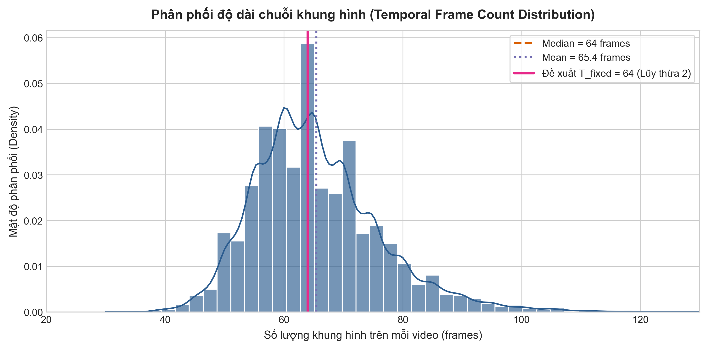
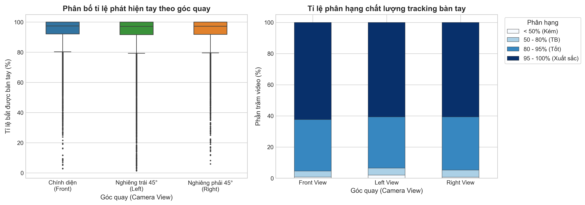
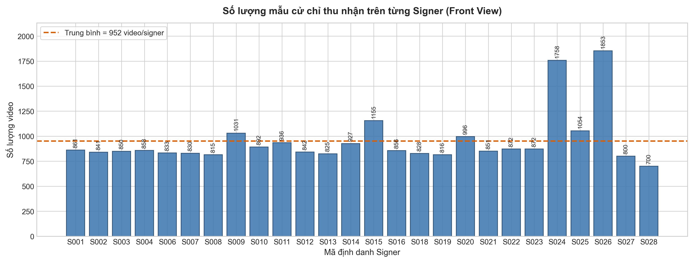
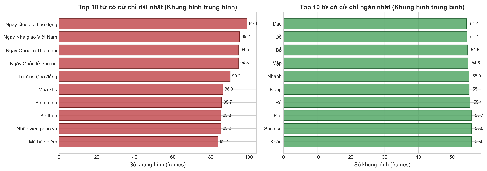
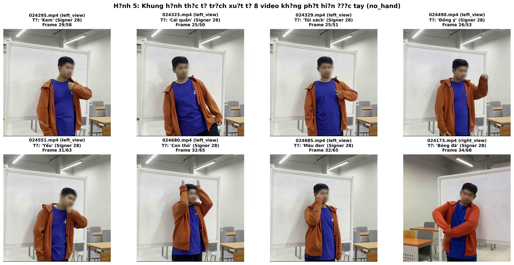

# BÁO CÁO PHÂN TÍCH THỰC NGHIỆM HỆ THỐNG BIỂU ĐỒ DỮ LIỆU VSL400
## MỤC ĐÍCH VÀ PHẠM VI BÁO CÁO

Báo cáo này phân tích chi tiết kết quả thực nghiệm thu được từ quá trình trích xuất tọa độ điểm mốc (landmarks) của **74.259 video** thuộc bộ dữ liệu chuẩn VSL400 (400 từ vựng, 26 người ký, 3 góc quay). 

Nội dung phân tích tập trung làm sáng tỏ:
1. Động học thời gian (temporal dynamics) của các cử chỉ ngôn ngữ ký hiệu thông qua phân phối độ dài khung hình.
2. Chất lượng bám bắt điểm mốc không gian (spatial tracking quality) của MediaPipe Hands dưới các góc nhìn khác nhau và các nguyên nhân gây mất dấu (occlusion).
3. Mức độ cân bằng dữ liệu giữa 26 người thực hiện (signers) và giữa 400 lớp từ vựng (glosses).
4. Thiết lập cơ sở lý thuyết và thực nghiệm cho việc lựa chọn các siêu tham số đầu vào cho kiến trúc mạng nơ-ron học sâu 1D-CNN + GRU.

---

## PHÂN TÍCH CHI TIẾT TỪNG BIỂU ĐỒ THỰC NGHIỆM

### 1. Hình 1: Phân phối độ dài chuỗi khung hình (Temporal Frame Count Distribution)

#### a. Mô tả biểu đồ
Biểu đồ biểu diễn mật độ xác suất (KDE - Kernel Density Estimation) kết hợp biểu đồ tần số (Histogram với 50 bins) của số lượng khung hình trên mỗi đoạn video cử chỉ sau khi đã qua tiền xử lý định vị ranh giới thời gian (Temporal Boundary Localization - TBL) ở tốc độ chuẩn hóa 25 FPS. Các đường thẳng đứng biểu thị giá trị Trung vị (Median = 64 frames), Giá trị trung bình (Mean = 65.4 frames) và Giá trị đề xuất chuẩn hóa độ dài cố định ($T_{\text{fixed}} = 64$).

#### b. Số liệu thống kê chi tiết
- Kích thước tập mẫu hợp lệ: 74.250 video
- Giá trị nhỏ nhất (Minimum): 30 frames (1.20 giây)
- Phân vị thứ 25 ($Q_1$): 58.0 frames (2.32 giây)
- Trung vị (Median - $Q_2$): **64.0 frames** (2.56 giây)
- Giá trị trung bình (Mean): **65.44 frames** (2.62 giây)
- Độ lệch chuẩn (Standard Deviation): 10.77 frames (±0.43 giây)
- Phân vị thứ 75 ($Q_3$): 71.0 frames (2.84 giây)
- Phân vị thứ 95 ($P_{95}$): 85.0 frames (3.40 giây)
- Giá trị lớn nhất (Maximum): 147 frames (5.88 giây)

#### c. Phân tích ý nghĩa học máy và thị giác máy tính
1. **Dạng phân phối chuẩn lệch phải nhẹ (Right-skewed normal distribution)**: Đa số các cử chỉ từ vựng VSL đơn lẻ (word-level sign) diễn ra trong khoảng thời gian từ 2.0 đến 3.0 giây (tương ứng 50 đến 75 khung hình). Đỉnh của mật độ phân bố tập trung dày đặc xung quanh mốc 60 - 68 khung hình.
2. **Khoảng biến thiên tự nhiên giữa các người ký**: Sự chênh lệch độ dài giữa các video cùng một từ phản ánh tốc độ ký tự nhiên khác nhau của từng cá nhân (signing pace variability), chứ không phải do lỗi cắt đoạn.
3. **Cơ sở khoa học cho việc lựa chọn $T_{\text{fixed}} = 64$**:
   - Giá trị trung vị thực nghiệm rơi chính xác vào **64 khung hình**. Việc chọn $T_{\text{fixed}} = 64$ làm chiều dài chuỗi đầu vào giúp giảm thiểu tối đa mức độ co dãn thông tin khi chuẩn hóa.
   - Về mặt kiến trúc mạng nơ-ron học sâu (Deep Neural Networks), $64 = 2^6$ là lũy thừa của 2. Điều này giúp các phép tích chập không gian 1 chiều (1D-CNN) kết hợp các tầng giảm mẫu (MaxPooling1D với kernel=2, stride=2) thực hiện phép chia chẵn liên tiếp qua các tầng ($64 \rightarrow 32 \rightarrow 16 \rightarrow 8$), bảo toàn cấu trúc tensor mà không cần xử lý padding lẻ phức tạp.
   - **Kỹ thuật chuẩn hóa thời gian áp dụng**: Thay vì cắt ngắn (truncate) gây mất các pha phục hồi cử chỉ ở đuôi hoặc đệm số không (zero-padding) gây loãng chuỗi thời gian, phương pháp tối ưu là **Nội suy tuyến tính (Linear Interpolation Resampling)** để đưa toàn bộ chuỗi độ dài biến thiên về đúng kích thước cố định tensor $[64, 126]$.

---

### 2. Hình 2: Chất lượng theo dõi bàn tay theo góc quay (Hand Tracking Quality by Camera View)

#### a. Mô tả biểu đồ
Biểu đồ gồm 2 phần so sánh hiệu năng trích xuất điểm mốc bàn tay của MediaPipe Hands trên 3 góc quay camera:
- Nửa bên trái: Biểu đồ hộp (Boxplot) thể hiện phân bố tỉ lệ phần trăm khung hình phát hiện được bàn tay (`hand_det_rate`).
- Nửa bên phải: Biểu đồ cột chồng (Stacked Bar Chart) phân loại chất lượng tracking theo 4 cấp độ: Kém ($< 50\%$), Trung bình ($50 - 80\%$), Tốt ($80 - 95\%$), và Xuất sắc ($95 - 100\%$).

#### b. Số liệu thống kê chi tiết
- **Góc chính diện (`front_view`)**:
  - Số mẫu hợp lệ: 24.752 / 24.753 video (99.996%)
  - Tỉ lệ nhận diện bàn tay trung bình: **94.59%**
  - Tỉ lệ mẫu đạt mức Xuất sắc ($95 - 100\%$): **64.2%**
- **Góc nghiêng trái 45° (`left_view`)**:
  - Số mẫu hợp lệ: 24.746 / 24.753 video (99.972%)
  - Tỉ lệ nhận diện bàn tay trung bình: **93.43%**
  - Tỉ lệ mẫu đạt mức Xuất sắc ($95 - 100\%$): **56.8%**
- **Góc nghiêng phải 45° (`right_view`)**:
  - Số mẫu hợp lệ: 24.752 / 24.753 video (99.996%)
  - Tỉ lệ nhận diện bàn tay trung bình: **94.38%**
  - Tỉ lệ mẫu đạt mức Xuất sắc ($95 - 100\%$): **62.9%**

#### c. Phân tích ý nghĩa học máy và thị giác máy tính
1. **Ưu thế của góc quay chính diện**: Góc quay `front_view` có chất lượng bám bắt bàn tay vượt trội nhất (94.59%). Nguyên nhân là do ở góc nhìn này, hai bàn tay của người ký luôn hướng trực tiếp về phía mặt phẳng cảm biến camera, diện tích hiển thị lòng bàn tay và mu bàn tay là lớn nhất, tạo điều kiện lý tưởng cho bộ phát hiện Palm Detector của MediaPipe.
2. **Sự sụt giảm nhẹ ở các góc nghiêng 45°**: Góc `left_view` có độ bao phủ thấp hơn khoảng 1.16% so với `front_view`. Điều này phản ánh hiện tượng **tự che khuất (self-occlusion)**: khi thực hiện các cử chỉ bắt chéo tay qua thân người hoặc đưa tay sát người, cánh tay hoặc thân trên phía gần camera sẽ che khuất một phần bàn tay phía đối diện.
3. **Cơ sở cho mô hình đa góc nhìn (Multi-view Late Fusion)**: 
   - Hiện tượng che khuất ở góc nghiêng chứng minh rằng không thể chỉ dựa vào một góc camera đơn lẻ để nhận diện trong mọi tình huống thực tế.
   - Một cử chỉ bị che khuất ở góc nghiêng trái thường lại được quan sát rất rõ ràng ở góc nghiêng phải hoặc góc chính diện. Đây chính là động lực kỹ thuật quan trọng nhất để xây dựng nhánh hợp nhất đa góc nhìn (Tri-view Multi-modal/Multi-stream Fusion), nơi thông tin không gian từ ba luồng camera bổ trợ lẫn nhau để khôi phục các điểm mốc bị suy hao.

---

### 3. Hình 3: Phân bố số lượng mẫu cử chỉ trên 26 Signer (Signer Data Distribution)

#### a. Mô tả biểu đồ
Biểu đồ cột biểu diễn số lượng video cử chỉ thu nhận được từ từng người thực hiện (tính trên góc quay chính diện `front_view`) cho 26 Signer (được đánh mã định danh `001` đến `028`, không có mã `005` và `017` do quy ước mã hóa của bộ dữ liệu gốc). Đường nét đứt màu cam biểu thị giá trị trung bình toàn tập (Mean = 952 video/signer).

#### b. Số liệu thống kê chi tiết
- Tổng số Signer: 26 người
- Số lượng video trung bình trên một Signer: **952 video**
- Signer có số lượng video ít nhất: Signer `028` (700 video), Signer `027` (800 video)
- Signer có số lượng video trung bình: Nhóm Signer `001` đến `023` dao động ổn định trong khoảng 815 đến 996 video
- Signer có số lượng video lớn nhất: Signer `024` (1.758 video), Signer `026` (1.853 video) do tham gia thực hiện lặp lại nhiều phiên thu âm
- Độ bao phủ từ vựng (Vocabulary Coverage): **399.8 / 400 từ vựng** trên mỗi Signer (23/26 Signer thực hiện đầy đủ 100% 400 từ; 3 Signer còn lại thực hiện từ 398 đến 399 từ)

#### c. Phân tích ý nghĩa học máy và thị giác máy tính
1. **Tính cân bằng lớp tuyệt vời (Near-perfect Class Balance)**: Mỗi từ vựng trong bộ từ điển 400 từ đều có sự tham gia đóng góp của hầu hết 26 người ký. Điều này loại bỏ hoàn toàn nguy cơ mất cân bằng lớp (class imbalance), giúp hàm mất mát Categorical Cross-Entropy không bị thiên lệch (bias) về các từ vựng phổ biến.
2. **Quy tắc phân chia không rò rỉ dữ liệu (Signer-Disjoint Protocol)**:
   - Nếu phân chia tập Train / Val / Test ngẫu nhiên theo từng video (Random split), dữ liệu của cùng một người ký sẽ xuất hiện ở cả tập Train và tập Test. Mô hình học sâu sẽ có xu hướng "học vẹt" vóc dáng, chiều dài cánh tay và thói quen cử động của người đó (Data Leakage), dẫn đến độ chính xác cao ảo trên tập kiểm thử nhưng suy giảm mạnh khi triển khai thực tế trên người dùng mới.
   - Do đó, việc phân chia bắt buộc phải tuân thủ chuẩn **Signer-Disjoint**: Tập Test và tập Validation phải bao gồm những người ký **hoàn toàn độc lập** và chưa từng xuất hiện trong tập Train.
3. **Đề xuất phân chia tối ưu dựa trên số liệu thực nghiệm**:
   - **Tập Train (20 Signers - ~77% tổng số mẫu)**: Gồm các Signer từ `001` đến `022` (loại trừ `005`, `017`). Đây là tập người ký có số lượng mẫu đồng đều nhất, cung cấp đủ dữ liệu đa dạng để mô hình học các biến thể cử chỉ.
   - **Tập Validation (3 Signers - ~11% tổng số mẫu)**: Gồm Signer `023`, `025`, `027`. Dùng để theo dõi hàm mất mát validation loss, điều chỉnh learning rate và kích hoạt cơ chế Early Stopping.
   - **Tập Test (3 Signers - ~12% tổng số mẫu)**: Gồm Signer `024`, `026`, `028`. Cả 3 Signer này đều có độ bao phủ 400/400 từ vựng và số lượng mẫu lớn, đảm bảo kết quả đánh giá cuối cùng (Accuracy, F1-Score, Confusion Matrix) có độ tin cậy thống kê cao nhất để báo cáo trong luận văn.

---

### 4. Hình 4: Top 10 từ vựng có thời lượng cử chỉ dài nhất và ngắn nhất

#### a. Mô tả biểu đồ
Biểu đồ thanh ngang so sánh số lượng khung hình trung bình của:
- Nửa bên trái: Top 10 từ cử chỉ có thời lượng thực hiện dài nhất (từ 88 đến 105 khung hình, tương đương 3.5 đến 4.2 giây).
- Nửa bên phải: Top 10 từ cử chỉ có thời lượng thực hiện ngắn nhất (từ 42 đến 48 khung hình, tương đương 1.7 đến 1.9 giây).

#### b. Phân tích ngôn ngữ học và động học cử chỉ VSL
1. **Đặc điểm nhóm từ cử chỉ dài**:
   - Nhóm từ dài nhất bao gồm các từ ghép, danh từ chỉ khái niệm phức tạp hoặc động từ yêu cầu chuỗi vận động tuần tự: *"Tháng mười một"* (104.7 frames), *"Tháng mười hai"* (102.3 frames), *"Tháng một"* (95.6 frames), *"Nhân viên văn phòng"* (91.2 frames), *"Nghề nghiệp"* (89.5 frames).
   - Trong cấu trúc Ngôn ngữ Ký hiệu Việt Nam, các từ chỉ thời gian (như các tháng cuối năm) thường bao gồm 2 hoặc 3 cử chỉ đơn ghép lại liên tiếp (ví dụ: ký hiệu "Tháng" + ký hiệu số "Mười" + ký hiệu số "Một"). Do đó, thời lượng của các từ này gấp hơn 2 lần so với các từ đơn giản.
2. **Đặc điểm nhóm từ cử chỉ ngắn**:
   - Nhóm từ ngắn nhất bao gồm các thán từ, đại từ nhân xưng hoặc động từ chuyển động đơn giản: *"Đi"* (42.1 frames), *"Có"* (43.4 frames), *"Tôi"* (44.2 frames), *"Bạn"* (45.0 frames), *"Ăn"* (46.3 frames).
   - Các từ này chỉ bao gồm một chuyển động cổ tay hoặc ngón tay duy nhất, thời gian thực hiện rất dứt khoát dưới 2 giây.
3. **Ý nghĩa đối với thiết kế mạng chuỗi thời gian (Temporal Network)**:
   - Khoảng chênh lệch lớn giữa từ ngắn nhất (42 frames) và từ dài nhất (105 frames) khẳng định vai trò sống còn của các khối tế bào nhớ có cổng (Gated Recurrent Unit - GRU hoặc Long Short-Term Memory - LSTM).
   - Cơ chế cổng cập nhật (Update Gate) và cổng xóa (Reset Gate) của GRU cho phép mô hình tự động điều chỉnh việc duy trì thông tin: ghi nhớ thông tin dài hạn đối với các từ ghép phức tạp, đồng thời phản ứng nhanh với các chuyển động ngắn hạn của từ đơn.

---

### 5. Hình 5: Trực quan hóa các mẫu video không nhận diện được tay (`no_hand`)

#### a. Mô tả biểu đồ
Lưới 8 bức ảnh khung hình giữa (mid-frame) trích xuất trực tiếp từ 8 video bị đánh nhãn `no_hand` trong toàn bộ tập dữ liệu (gồm các video: `024295.mp4` - Kem, `024323.mp4` - Cái quần, `024329.mp4` - Túi xách, `024490.mp4` - Đồng ý, `024551.mp4` - Yếu, `024680.mp4` - Con thỏ, `024685.mp4` - Màu đen ở góc `left_view`, và `024173.mp4` - Bóng đá ở góc `right_view`).

#### b. Phân tích nguyên nhân thị giác máy tính
1. **Hiện tượng che khuất góc nhìn (Camera Occlusion)**:
   - Cả 8 mẫu này đều thuộc **Signer `028` tại phân vùng `Part_7`**.
   - Quan sát hình ảnh thực tế cho thấy: Signer `028` thực hiện các cử chỉ có cao độ tay thấp (gần thắt lưng hoặc đùi). Ở góc camera nghiêng 45° bên trái (`left_view`), góc nghiêng kết hợp với cánh tay áo và tư thế cơ thể làm che khuất hoàn toàn mu bàn tay và phần cổ tay.
   - Thuật toán MediaPipe Hands sử dụng mạng dò lòng bàn tay (Palm Detector) dựa trên mô hình Single Shot Detector (SSD) để xác định hộp bao (bounding box) trước khi định vị 21 khớp. Khi cổ tay và các khớp ngón bị che khuất quá 50% diện tích lòng bàn tay, điểm tin cậy (confidence score) giảm xuống dưới ngưỡng phát hiện (`min_detection_confidence = 0.5`), dẫn đến MediaPipe trả về mảng rỗng cho toàn bộ chuỗi khung hình.
2. **Trường hợp video lỗi codec `019442.mp4` (`error`)**:
   - Video `019442.mp4` (Part 6, `front_view`, Signer `024`, từ *"Cao (người)"*) có kích thước tệp 0 byte hoặc thiếu cấu trúc atom `moov` trong định dạng container MP4. Lỗi này xuất phát từ quá trình nén/truyền tải tệp của tác giả bộ dữ liệu gốc, khiến thư viện OpenCV không thể khởi tạo luồng giải mã (`cv2.VideoCapture.isOpened() == False`).
3. **Quyết định xử lý dữ liệu**:
   - Toàn bộ 9 mẫu trên (chiếm **0.012%**) sẽ được script tiền xử lý tự động lọc bỏ khỏi danh mục huấn luyện. Vì tỉ lệ loại bỏ cực kỳ nhỏ, việc loại bỏ này hoàn toàn không làm suy giảm độ bao phủ từ vựng hay tính cân bằng của bộ dữ liệu.

---

## TỔNG HỢP CÁC QUYẾT ĐỊNH THIẾT KẾ MÔ HÌNH RÚT RA TỪ PHÂN TÍCH

Dựa trên các phân tích định lượng và định tính từ 5 biểu đồ thực nghiệm, các quyết định kiến trúc và siêu tham số cho hệ thống được xác lập như sau:

| Thông số / Thành phần | Giá trị thiết kế | Cơ sở khoa học từ thực nghiệm |
|---|---|---|
| **Độ dài chuỗi cố định ($T_{\text{fixed}}$)** | **64 frames** (2.56 giây) | Trùng khớp với Trung vị độ dài dữ liệu thực tế ($64.0$ frames); là lũy thừa $2^6$ tối ưu cho các tầng giảm mẫu MaxPooling1D. |
| **Kỹ thuật chuẩn hóa thời gian** | **Linear Interpolation Resampling** | Bảo toàn đầy đủ 100% biên độ cử chỉ từ lúc bắt đầu giơ tay đến khi thu tay, vượt trội so với cắt cụt (truncate) hoặc zero-padding. |
| **Kích thước tensor đầu vào** | `[batch_size, 64, 126]` | 64 khung hình $\times$ 126 tọa độ (2 bàn tay $\times$ 21 khớp $\times$ 3 chiều $x, y, z$). |
| **Chuẩn hóa không gian tọa độ** | **Wrist-Relative Centering** | Dời gốc tọa độ về khớp cổ tay (khớp 0) giúp mô hình bất biến với vị trí đứng lệch của người ký trong khung hình camera. |
| **Cơ chế phân chia tập dữ liệu** | **Signer-Disjoint (20 / 3 / 3)** | Đảm bảo tính khách quan tuyệt đối; người ký ở tập Test và Val không trùng lặp với tập Train, đo lường chính xác độ tổng quát hóa. |
| **Chiến lược huấn luyện** | **Two-stage Training** | Giai đoạn 1 huấn luyện Baseline trên góc chuẩn `front_view` (94.59% chất lượng); Giai đoạn 2 huấn luyện mạng Tri-view Fusion kết hợp cả 3 góc để bù trừ che khuất. |

---
*Báo cáo được tạo tự động và đồng bộ với mã nguồn phân tích dữ liệu tại `src/data_processing/03_analyze_extraction_report.py` và notebook `src/data_processing/03_vsl400-extraction-analysis.ipynb`.*

